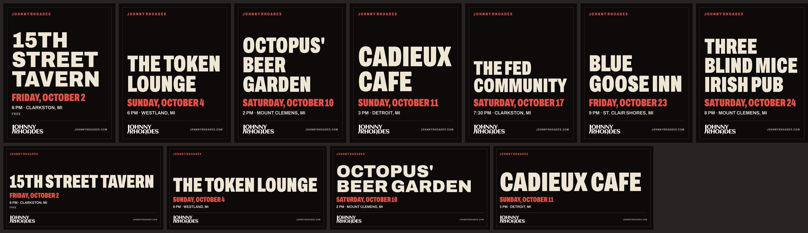

# Case study notes

A running log for the portfolio write-up (PLAN.md section 16): numbers, screenshots and surprises, captured as they happen. Newest first.

---

## 2026-11-24: The blues maker becomes a game, and two blind playtests make it one

**What changed.** The blues maker opens as a game (ADR 0033): pick a gig, the band's harp plays a two-bar call, you answer on the pads, and the crowd decides. The controls from before are an advanced mode behind a switch.

**The playtest.** Two agents who hadn't seen the code played it cold: one as a casual phone visitor, one as a guitarist on a laptop with no sound. They rated it 4/10 and 5/10, and the reasons were specific:

- the prompt and the pads were 1,200 to 1,500 px apart;
- without sound, the call was invisible;
- the scoring barely told playing from not playing. Random taps averaged 60 an answer and careful playing 79; eight of the same note scored "Nice, +78";
- the crowd meter was full by the fourth answer and couldn't fall;
- the first turn on the easy gig came 21 seconds in, and the last line couldn't be answered.

**The fixes, measured.**

| | Before | After |
|---|---|---|
| Random taps, per answer | 60 (playtest) | 63 (400 simulated); one star, not two, and the crowd cools |
| Mashing, per answer | 47 (playtest) | 49 (simulated); the crowd walks out in three turns |
| One note eight times | 78 | at most 60 |
| Same answer as last time | no penalty | variety drops to 30% |
| First turn, easy gig | 21 s | 9 s |
| Answers in a two-chorus gig | 5 | 6 (the band tags the ending after your last one) |
| Panel and pads on a 375×667 phone | two screens apart | one screen, pads end at 628 px |

Random tapping still averages about the same: half the time, timing and the last note are luck. What changed is what it earns and what it's told. A clean answer scores 100, and anything less loses points for the specific thing it got wrong. Scoring is five named parts (timing 35, ending 20, space 15, echo 15, variety 15). Echo compares the answer's rhythm with the call's, slot by slot, allowing a beat's nudge, so the same number of notes somewhere else scores nothing. Each answer shows its breakdown, and the weakest part comes with a tip. Good answers in a row build a streak. Below 70 the crowd cools, so coasting drains it, and three missed turns empty the room. Stars moved to 70% and 85%, so tapping at random earns one star, not two.

**Things worth telling**

- *The call has to be visible.* The pads light as the band plays its call, the line draws it note by note, and on your turn the call's rhythm shows as ticks under where you answer. A player with the sound off can still play.
- *"Unclear you're supposed to match the notes on the right."* Joe's first go found what the agents hadn't: the drawing needed words. The halves now read "The band calls" and "You answer", a line under the prompt says what to do, and on your turn the 1 and 5 pads light up as the places to land.
- *"The band needs to be interactive."* Joe's next note: the stage had become scenery in the game. Now the band stands between the panel and the pads, and each player does something when tapped. You choose who you trade with, cue the drummer's fill, drop the band out under your answer, or switch your horn. The band also plays to the room: softer to a cool crowd, digging in when it's hot, and a crash on the downbeat after a great answer. That last one needed a trick. The band schedules each bar about 0.3 s ahead, so it can't wait for the score. It judges the answer so far as it reaches the next line instead. Fitting the band onto a 375×667 phone with everything else took the form out of the layout (`display: contents`), so the stage could move up beside the gig.
- *Audio latency is part of timing.* A note is stamped with the audio clock when it's pressed, but the player is pressing to what they heard, which comes out of the speakers `outputLatency` later. The game subtracts it. On Bluetooth headphones that's well over the 35 ms pocket.
- *The iPhone ringer switch mutes Web Audio.* Setting `navigator.audioSession.type = 'playback'` (Safari 17 and later) lets the band play anyway, as a music app would. The gig page also says to check the switch.

---

## 2026-11-24: Deeply sampled instruments, layers, takes and strums

**What changed.** Drums, basses, guitars, piano and sax now come from free, deeply sampled libraries (Virtuosity and Swirly drums, Meatbass, Growlybass, Shinyguitar, Salamander, MTG Solo Sax), recorded at several loudnesses and in several takes, and the guitar strums (ADR 0032).

**Numbers**
- Samples: 92 → 354 (2 or 3 loudness layers, up to 4 takes a hit), library 2.3 → 6.1 MB at 64 kbps, a default band at most 2.3 MB.
- Pitch: every note within 25 cents but two, which the browser retunes from their measurement.

**Worth telling**
- *The renderer silently truncated notes.* sfizz streams samples, and an offline render outran the stream, cutting notes to 0.2 s, but only for some notes. A loudness envelope of the render found it; one SFZ opcode (`hint_ram_based`) fixed it.
- *Leveling had flipped the dynamics.* Normalizing every sample to the same loudness under a peak ceiling made the hardest-played layers the quietest, since their attacks hit the ceiling first. Leveling 6 dB lower fixed it, and a test now fails if a harder layer is quieter than a softer one.
- *An octave check that knows about basses.* A pitch tracker can't tell a bass's weak low E from a sample an octave up. Measuring whether the note's own frequency is there at all can, and it caught a library mapped an octave off.

---

## 2026-11-24: Real instruments instead of generated ones

**What changed.** The blues maker's instruments and drums are now real recorded samples from the MuseScore General soundfont (MIT), rendered note by note with FluidSynth, in place of ElevenLabs one-shots that had to be retuned (ADR 0031).

**Numbers**
- Pitch: from "two takes per instrument, stretched up to 16 semitones" to every sample rendered at its own note, measured within 14 cents (harmonica within 1).
- Build: one FluidSynth render per instrument instead of per note took `npm run jam:sounds` from about 4.5 minutes to under 1.5.
- Size: 92 files, about 2.3 MB, about the same as before.

**Worth telling**
- *The organ looked out of tune and wasn't.* Its drawbars together only repeat two octaves under the key (an E3 repeats at E1), so a pitch check looking near the note found nothing. Checking for any octave of the right note fixed the check, not the organ.
- *Licenses decided the source.* The deeper free libraries had no freely licensed drawbar organ or blues harmonica, and a popular prerendered set states its license two different ways. One MIT soundfont covered every instrument, and its notice now ships on the page beside the samples it covers.

---

## 2026-11-22: The blues maker

**What changed.** `/jam/` makes a 12-bar blues: key, feel, tempo, quick change, and a tone (or nothing) for drums, bass, guitar, keys, fills and the room. The 28 sounds were generated once with ElevenLabs' sound-effects model, and the browser plays them as a band (ADR 0030).

**Worth telling**

- *Generated once, played forever.* No server, no key on the site, no per-visitor cost. A song only downloads the samples its key and feel use.
- *The model doesn't take requests, so the notes are tuned afterwards.* Asked for E1, A1, E3, A3 and so on, it mostly returned C, in whatever octave it liked. Writing the frequency into the prompt didn't help, and the harmonica came back on C5 five times running (C is the commonest harp key). So the script measures each original's pitch with YIN, then pitch-shifts it with TD-PSOLA into a tuned sample every three semitones: 78 samples from 18 originals, each measured again and within 15 cents. In the browser no note bends more than a semitone and a half, down from up to 14 with the raw recordings.
- *The harmonica found a bug in the shifter.* Every harp note failed to tune, even one semitone from the original. Snapping pitch marks to the biggest swing flips between peaks and troughs on a buzzy sound, so the grains landed half a period out of line. Snapping to the positive peak of a smoothed copy fixed it.
- *Leveled by loudness, not by peak.* With every file normalized to the same peak, one guitar's notes still spread 8 dB and the record crackle sat at −42 dB. Leveling by loudness (RMS over the first 300 ms) brought every tone within 3.5 dB, and a test keeps it there.
- *The band, drawn.* The instruments are SVG line drawings in the strum neck's style, driven off the Web Audio clock: strings shake on the string a player would use, keys go down, drums dip. Each string stores its own ends, so one wobble function shakes strings drawn at any angle. Under reduced motion only the colors change. End-to-end tests check both.
- *A console in Web Audio.* Each strip is shelf EQ → stereo panner → fader → analyser, with a post-fader send to a convolution reverb whose impulse is generated noise, darkened as it rings. The master runs through a WaveShaper drive and a compressor. Every control glides with `setTargetAtTime`. End-to-end tests read the real meters to prove mute and solo silence the right strips.
- *A bandleader, not a loop.* The band plays choruses of different kinds (the tune, a solo, a breakdown, stop time, an ending) and arranges itself unless the visitor calls the next one. A single unit test plays all five kinds in every key, feel and tone (thousands of bars) and checks every note stays within its samples. An end-to-end test calls "Take it home" and waits for the band to finish on its own.
- *Sitting in.* Eight pads in the blues scale of the song's key, on four instruments, held and bent like the strum's string. The meters in the test prove the note goes through the right channel strip.
- *Call and response, at last.* ADR 0018 was waiting on Johnny's licks for the guitar to answer the visitor. Here the fills answer in bars 3–4, 7–8 and 11–12, and his real licks can replace them later.

---

## 2026-11-22: The next page arrives before the click

**What changed.** Pages tell Chrome and Edge to fetch a linked page's HTML when someone hovers over it or starts to tap it, so the click lands at once (Speculation Rules, ADR 0029). It's a small JSON block in each page's `<head>`, allowed by its hash in the CSP: no JavaScript.

**Worth telling**

- *Prefetch, not prerender, on purpose.* Prerendering would run the next page, so Google Analytics would count visits that never happened, and the guitar could wake up on a page nobody opened. Prefetching only fetches the HTML.
- *Proved, not assumed.* An end-to-end test hovers a link, clicks, and checks that the browser reports the page as `navigational-prefetch`.
- *The textbook way cost 0.9 s in the lab.* The usual delivery is a response header pointing at a rules file. An A/B test on the same build read home LCP 2.63 s with it and 1.73 s without, though nothing waited on the file. The simulation charged the hero for its extra request and connection. Inline, hashed into the CSP like the stylesheet, there's no request and no difference.
- *The A/B tests corrected an earlier claim.* They showed this machine's Lighthouse batches vary by about 0.3 s, so the press kit gain credited to inlining the stylesheet was within the noise. The home page gain held. ADR 0028 now says so.

---

## 2026-11-22: The stylesheet goes inline

**What changed.** The stylesheet is inline in every page, and the CSP allows it by a sha256 the build computes (ADR 0028). That was possible only once the headers became a file the build writes.

**Numbers** (Lighthouse CI, mobile, median of 3, over HTTP/2):
- Press kit LCP 1905 → 1605 ms, though later runs put that within the noise (see the entry above).
- Home LCP 1800 → 1726 ms, steady across every batch since.
- Show page unchanged at 1455 ms.
- 100 everywhere.

**Worth telling**

- *Estimates are made over your test server.* Lighthouse had promised 455 ms for this. That figure came from the old HTTP/1.1 test server. Over HTTP/2 the request it removes was cheap, so the real gain was 74 to 300 ms.
- *Security didn't loosen.* No `'unsafe-inline'`: one exact hash, recomputed every build, and a test that fails if a page carries a `<style>` the policy doesn't allow.

---

## 2026-11-22: From GitHub Pages to Cloudflare Workers

**What changed.** Joe suggested Cloudflare Workers, and the site moved its hosting there (ADR 0027): static assets only, no Worker script. The build now writes `dist/_headers` and `dist/_redirects`. Staging moved the same day: the first deploy took about a minute, and new.johnnyrhoades.com served over HTTP/2 with every header and redirect in place.

**Numbers.**
- The launch runbook's cutover went from five dashboard redirect rules, a header Transform Rule, two cache rules, a GitHub verified domain and a certificate wait to one redirect rule, for `www`.
- The generated files hold 2 header rules and 9 redirects today, against Cloudflare's limits of 100 and 2,100.
- The build is 153 files against the free plan's 20,000.

**Worth telling**

- *The config that used to live in a dashboard is now code.* The security headers were text to paste into Cloudflare by hand, with a test that the doc matched the code. Now the build writes them, the CSP test serves the built file, and the Lighthouse server does too. The doc can't drift from what's served, because what's served is generated.
- *The constraint that shaped the design: no Worker script.* Cloudflare applies `_headers` and `_redirects` only to static files. A script, even a tiny one to redirect `www`, would have meant setting every header in code. One dashboard rule for `www` was the cheaper trade.
- *Reuse the build's own answer.* Changed show URLs were already meta-refresh stub pages. Rather than recompute which shows have old slugs, the build reads the stubs back into real 301s, so the logic lives in one place.
- *Checked before it ships.* `wrangler dev` served the real build locally: the headers, the immutable cache, every redirect, the 404, and `_headers` itself never served.

---

## 2026-11-22: The hero wasn't slow, the lab server was

**What changed.** Lighthouse CI serves the build over HTTP/2, as GitHub Pages and Cloudflare do (ADR 0026). No change to the page.

**Numbers.** Home LCP, mobile, median of 3: 2.71 s → 1.74 s, performance 94–96 → 100. Show page 1.76 s, press kit 1.88 s. Staging, measured the same way: 1.78–1.96 s.

**Worth telling**

- *Read the breakdown before you optimize.* "The hero image" had been the open item for weeks. Lighthouse's own breakdown said the image loaded in 12 ms and 83% of LCP was render delay. Unthrottled, the hero painted at first paint, about 130 ms in.
- *The simulation models your server, not production.* lhci's static server speaks HTTP/1.1, so the slow-4G model queued 33 early requests six at a time. Production multiplexes them over HTTP/2. Measured the way it's served, the page was already under the bar.
- *The obvious fixes cost more than they saved.* Inlining the CSS would have meant hand-editing a CSP hash in Cloudflare on every style change. The font trims saved 1.5 KB and 5 KB.

---

## 2026-11-22: The search baseline, from Ahrefs

**What changed.** A search "before", measured with Ahrefs while the domain still serves Bandzoogle (`docs/search-baseline.md`). It found the gaps, and the fixes all use facts the ledger already had. His Apple Music artist page goes into `sameAs`. The structured data now ties him to Motor City Josh & The Big 3 and to John Németh's *Feelin' Freaky*, and names the band's older billing. `llms.txt` says which Johnny Rhodes he isn't.

**Numbers.** Domain Rating 0.1, no organic keywords, no traffic. johnnyrhoades.com isn't in the top 10 for his own name. The top result is Facebook's people search and the second is his Apple Music page. Of 25 referring domains, one was a real link (Pure Michigan, DR 78, an event listing that expired in July), and the rest are link spam. "johnny rhoades" gets about 10 searches a month. "johnny rhodes" gets 150, all about other people.

**Worth telling**

- *The biggest search problem wasn't on the site.* Bandsintown has had nothing upcoming for him since Oct 24, so Detroit's Bandsintown blues page, which is the kind of page that ranks for "blues bands near me", listed six shows by other players and none by him. The sync was fine; its log said `0 upcoming, 609 past` every three hours.
- *A test that only failed in winter.* The rule for 1:30 am on the night clocks fall back is to take the first one, in daylight time. Luxon picks between the two by the offset in effect when the code runs, so all summer the test passed, and in November it failed. Shows aren't booked at 1:30 am, but the fix is now explicit, and the test runs as if built in July and in December.
- *A dead site held the missing bio.* The #3 result for his name was a 2013 profile of his on a site that's now down. The Wayback Machine's copy named his old domain, which led to the Kickstarter that funded his first full-length record, and it mentioned an EP and a touring credit with Kelley Hunt that weren't in the ledger. Joe confirmed it was Johnny's own, so it went into his bio, and every artist the bio names now links to their own page (ADR 0025).
- *Two tests expired on Oct 25.* The booking tests typed Oct 24 into a date field whose minimum is the browser's today, so once that date passed, the browser refused to submit. They now pin the browser's clock to the build date, as the show tests already did.

---

## 2026-10-05: Johnny reads his bio

**What changed.** Johnny's first notes on his own About section: don't say "I", say "he"; and it sounds repetitive. Both came from the ledger. Every sentence was one fact, written to stand on its own, so every sentence started the same way. Facts now carry a second wording for their place in the running bio, which can lean on the sentence before ("Since then…", "Years later…"). The home page About and the press kit's medium bio became one text (ADR 0022). He also asked for his current work with Jill Jack and Julianne Ankley, which went in as a `verified` fact from a Local Spins profile and a venue listing.

**Worth telling**

- *The guardrail shaped the prose.* The rule that kept claims honest (one fact, one sentence) is also what made it read like a list. The fix kept the rule and changed the wording, not the facts.
- *Test the complaint.* A unit test now fails if three sentences in a row open with the same word.

---

## 2026-10-21: The guitar plays by default, and it was out of tune

**What changed.** The strummable neck now has sound on by default, unlocked by the visitor's first click or tap, with the switch as a mute (ADR 0024). Measuring the synthesized notes on the way found every one of them sharp, and the fix tunes them exactly.

**Numbers.** As shipped, the high E string was 13 to 17 cents sharp and the low E 2 to 3, so strings within one chord disagreed by up to 14.6 cents: a sour chord. Now every note of every chord is within 0.03 cents, at 44.1 and 48 kHz.

**Worth telling**

- *A comment was wrong and nobody could hear it.* The code said the averaging filter adds half a sample of delay; in this loop it takes half a sample away. With sound off by default almost nobody heard the guitar, so the error lived for weeks. Turning the sound on is what made it matter.
- *Test what you hear, not the arithmetic.* The old test checked the waveform repeated at the computed period, so it agreed with the bug. The new one measures the pitch by autocorrelation against a pure sine, and holds every chord tone to a cent.

---

## 2026-10-05: Real data in the tests, Formspree and Google Analytics

**What changed.** Every test now runs on the real Bandsintown capture (609 shows) instead of the nine hand-written mocks, and the mocks are gone (ADR 0006 closed). Both forms post to Formspree and analytics is Google Analytics, loaded only on the real domain, after the page is idle, and never for a browser that sends Global Privacy Control (ADR 0023). The footer credits the site, with Johnny's OK.

**Numbers.**

- Lighthouse LCP on the home page, simulated slow 4G: 2.88 s → 2.64 s, from re-encoding the logo mask as lossless WebP (59 KB → 27 KB, the same alpha bit for bit). Measured directly with a 4× slower CPU, the page paints in about 0.35 s; the simulation charges every early byte against the hero.

**Worth telling**

- *Real data found a false alarm and a real gap.* Five poster tests failed on the history. Every failure was a long date measured 0.0000000000001 px over a box it was sized to fill exactly: floating point, not overflow. The name check already had half a pixel of slack; the venue and date checks now do too.
- *Tests that count things go stale.* "9 calendar events" was true of the mocks. Against data that syncs every three hours, the end-to-end tests now work out their expected counts from `shows.json` with the site's own functions.
- *A new test found two old layout bugs.* Checking that no page scrolls sideways at five widths caught the mailing list form at about 1024 px (inputs refusing to shrink below 20 characters) and the press kit's logo buttons on phones. Both were already on staging.
- *Analytics without the bloat, mostly.* GA's script is much bigger than the site's whole JavaScript budget. Loading it after the page is idle keeps it out of the first paint and out of Lighthouse; the trade-off is written down rather than hidden.

---

## 2026-10-05: The first real Bandsintown data, and not asking Johnny to change

**What changed.** The first live capture had 609 shows going back to 2015. Not one had a title, which the plan had been counting on to say whether a show was solo, trio or a guest spot. Johnny had been labeling every show anyway, in front of the venue name: "Solo Acoustic @ The Whiskey Six". The site now reads that, in his own wording, and the naming guide no longer asks him for anything new (ADR 0020).

**Numbers.**

- 586 of 609 shows are now billed from his own labels: 239 solo, 290 sitting in with someone else, 19 with the Lucas Rhoades Band, 21 trio, 15 hosting, 2 full band.
- Counting rooms by name said 295 rooms. Stripping the labels brought that to 200, and counting by street address to 145, because he's typed some rooms up to eight ways.
- The proof line from the real history: "106 shows in the last year, in 35 rooms across 26 towns." By name it would have said 47 rooms.

**Worth telling**

- *Capture before you model, again.* The plan's own rule paid off. The mock was faithful to one event's shape and still missed the most important fact about the data: where Johnny writes things down.
- *The fix for a person is usually in the software.* The plan had a guide asking Johnny to type titles. Reading what he already types was a few hundred lines with tests; changing a working musician's habit wasn't going to happen.
- *The key was in the data.* Bandsintown echoes the API key into every event URL in its responses. Captures meant for a public repo now redact it before they're written.

---

## 2026-10-02: A second research pass, and the biggest credit wasn't on the site

**What changed.** Searching outside Johnny's own bio found two things bigger than anything in the press kit: he was John Németh's guitarist in the Blue Dreamers and plays on *Feelin' Freaky* (2017, produced by Luther Dickinson), and the band he still plays in, Motor City Josh & The Big 3, won Detroit Music Awards in 2020 and 2023. Both are `verified` with links and now lead the home page About, the bios, the press kit highlights and /llms.txt.

**Worth telling**

- *The ledger paid for itself in reverse.* The "Detroit Music Award nominee" line was held back for having no source. The research didn't find the nomination; it found two wins. Bringing the line back was a data change plus tests, no template work.
- *Spelling hides credits.* Elmore Magazine spells him "Johnny Rhodes", so searches on the right name miss it. Worth checking in the AI answer audit (docs/geo-audit-log.md).
- *Leads stay leads.* The B.B. King memorial is probably the May 27, 2015 tribute at W.C. Handy Park with Németh, and he's probably on Brett Lucas's award-winning *Soul and Courage*. Both are recorded in the ledger as leads, off the page, until Johnny confirms.

---

## 2026-10-02: The 12-bar strum, and the bend

**What changed.** The neck used to play one E7 however you played it. Now each strum plays the next bar of a 12-bar blues in E, with the chord name quietly under the neck, and pressing a string and pushing bends it up to a whole step. ADR 0018.

**Worth telling**

- *The idea came out of the music, not a feature list.* Asked for "something classic blues" that people could play with, the answer was in the form itself: the 12-bar progression and the string bend, B.B. King's move (one of the four players Johnny grew up on).
- *Strum or bend? The finger tells you.* Both start with a press on a string. A press that moves off within 110 ms is a strum; one that stays put is a bend. No mode switch and no instructions.
- *Still no audio files.* The chords are real open-position voicings from the same synthesized string, each note made once on first use. A muted string is a 50 ms dead thump. The bend is the playback rate gliding up to 2^(2/12), checked in the browser at 1.1223 against 1.1225.

**Next, from Johnny:** a handful of short licks in E, so his guitar can answer the visitor's strums in the gaps, the way a blues verse does call and response.

---

## 2026-10-02: The show card, after "something classic blues"

**What changed.** Joe wanted something classic blues on the site, "B.B. King or a velvet Jimi Hendrix poster." Rather than borrow their faces, the prototype borrows the form they toured on: the letterpress show card. It has IN PERSON across the top, JOHNNY RHOADES as big as the card allows, and the date in a solid red block, printed on bone stock. It's built from Johnny's real show data, like every other poster. ADR 0017.

**Worth telling**

- *Wood type, computed.* Each line of the name fills the full width, and each line picks its own Archivo width cut, the way a compositor pulled different type from the case. On the feed poster, JOHNNY comes out at 87.5% width and RHOADES at 75%, both about 224 px tall. Nobody chose those numbers; the space did.
- *Texture can hurt legibility.* The first version wore every stroke, and a void across the I in "CLARKSTON, MI" made it read "MI!". The fix copies the site's own rule (wear on display type only) without knowing which text is which: blur the ink, keep only the deep interiors, and wear those. Thin strokes never qualify.
- *Same speed.* A median of 86 ms per render with the texture, against 72 ms for the plain bill.

**Screenshots:** `docs/case-study/show-card-prototype-feed.jpg` (before above, after below) and `show-card-prototype-formats.jpg`.

**Verdict.** Joe, on seeing the prototype: "I like this aesthetic." He chose the card for every format, with Johnny's name biggest on guest spots too.

**Shipping it**

- *The texture tripled the PNG size, so the show page stopped loading the PNG.* Grain doesn't compress: the Instagram post went from 73 KB (the bill) to 171 KB, and palette PNG or WebP only got it to 85–100 KB. The page now inlines satori's own SVG of the same layout, about 16 KB gzipped. That one element is the poster on screen and the printed flyer: vector on white paper, one US Letter page. The textured PNGs stay for posting and link previews. A show page is now lighter than it was with the old poster.
- *A sharp surprise.* `blur().threshold()` in one sharp pipeline runs the threshold first, so "keep only deep interiors" quietly wore every stroke near ink, the 4 px test stroke included. The cut now happens in code after the blur. A unit test draws a heavy block and a 4 px stroke and checks that only the block wears.
- *Ink covers paper.* The first finish laid the paper grain over everything, so fibers showed through black type. Grain now goes on bare stock only, in the same pass as the wear.
- *A flaky test, found by the clock.* The home-page e2e test pinned the build date but not the browser clock. Once tonight's show ended at 9 pm, the hero correctly moved on and the test failed. It now sets the browser clock the way the Tonight tests do.
- *Removed:* the duotone photo slot. It had shipped empty, waiting on photographer credits, and the card has no room for a photo without shrinking the name.

---

## 2026-10-01: Drop the needle, and "am I free that night?"

**What changed.** You can hear the album now. Press play on a song and the tonearm swings onto the spinning record while a 30-second clip plays. And the booking form checks the date as you pick it: "I'm already playing The Fed Community in Clarkston that day." ADR 0016.

**Worth telling**

- *The record was always the right player.* It already spun on the page as decoration; giving it a tonearm made it the control people expect, without adding a new playful element.
- *Honest copy in a small place.* The date check never says "you're in luck, he's free". Johnny plays gigs that never reach Bandsintown, so the most it can truthfully say is "I don't have anything listed that day."
- *Zero bytes until asked.* No audio loads until someone presses play; the whole player is about 1.5 KB.
- *Testing sound without sound.* Playwright's Chromium can't decode AAC, so the tests serve seconds of WAV silence in place of Apple's clips and check everything around the audio: play, pause, switching songs, the needle lifting, failures, and the security policy.

---

## 2026-10-01: Print texture, after "needs texture"

**What changed.** The site looks printed now: screen-printed black, poster-stock bone and red, worn letterpress ink in the big type, and a rough paper edge where the bone and red sections start. Four generated tiles (37 KB), one stylesheet, no new colors. ADR 0015.

**Worth telling**

- *The first draft was a gimmick.* Big blotchy voids in the type looked like a "distressed" font from a template shop. The version that works is roughly a tenth as strong: you see it up close, and from across the room it just feels made.
- *Texture from code, not stock photos.* The tiles come from a seeded noise script, so they're seamless, reproducible, and free of licensing questions.
- *A one-line bug worth remembering.* The torn edge first overlapped the section above by half its height, so wherever the tear dipped deep, a thin line of the page behind showed through. It now overlaps by the full strip.

---

## 2026-10-01: Design pass, after "this website isn't world class"

**What changed.** Same colors, same typeface, same record and strum; different layout. The hero now says where Johnny plays next. Show lists read like a gig listing, with a date block and a bone "ticket" on hover. No more half-empty columns. Booking is a bone section, the mailing list a flat red band, and the photo grid closes square. ADR 0014.

**Before and after:** `docs/case-study/design-pass-before-desktop.jpg` and `design-pass-after-desktop.jpg` (and `-mobile`).

**Worth telling**

- *The critique was layout, not branding.* Every section used the same template: a giant heading over two columns, the left one mostly empty. Breaking that pattern did more than any new color or font would have, and none were added.
- *The most useful sentence on a gigging musician's site is "next show: Friday, 15th Street Tavern."* It was a full scroll down. Now it's under his name, and it updates itself when the show ends.
- *Lighter as well as better:* home page Lighthouse 96 to 97, 345 KB to 321 KB.

---

## 2026-09-30: Phase 7 prep, before touching anything

**What changed.** Nothing live. The launch is written down step by step (`docs/runbook-launch.md`) with a ten-minute rollback, the old site's URLs are mapped, and a script checks the redirects after cutover.

**Worth telling**

- *Look before you move.* Two public lookups changed the plan. The DNS was already on Cloudflare, so the "move DNS" step became "find out whose account it's on." And the MX records point at Zoho: Johnny has email on the domain. The plan's free Cloudflare Email Routing for `booking@` would have replaced those records and silently cut off his mailbox. `booking@` becomes a Zoho alias instead.
- *The old site was smaller than assumed.* Bandzoogle served seven URLs: the root, `/home` and five track pages. The pages the plan guessed at (`/music` and so on) were already 404s. Six redirect rows, one wildcard rule.

---

## 2026-09-30: Phase 6, hardening

**What changed.** The site now tells crawlers and answer engines what's there (a sitemap that follows the show data, a welcoming robots.txt, an `llms.txt` written from the facts ledger) and pings IndexNow after each deploy with only the show pages that changed. A Content Security Policy for Cloudflare is drafted and tested by serving the whole site under it. Lighthouse CI, html-validate and link checks run on every pull request.

**Lighthouse (mobile, local build, median of three)**

| Page | Performance | Accessibility | Best practices | SEO |
|---|---|---|---|---|
| Home | 96 | 100 | 100 | 100 |
| Show page | 100 | 100 | 100 | 100 |
| Press kit | 97 | 100 | 100 | 100 |

Home ships 10 KB of JavaScript (budget 30 KB) and 345 KB in total (budget 600 KB).

**Worth telling**

- *Measuring found what reading didn't.* The home page had no Largest Contentful Paint at all: the hero photo faded in from invisible, and Chrome doesn't count invisible things. Lighthouse couldn't score it. The photo now settles from a slight zoom instead, visible from the first frame.
- *A banner that moved the page.* Past show pages revealed "This show has happened" with script, every time, shifting everything below it (CLS 0.11). The build already knew; now the HTML says it. CLS 0.
- *27 KB nobody would miss.* The font covered widths up to 125%; the site never goes past 100%. Trimming the axis took it from 90 KB to 63 KB, pixel-identical at every width and weight in use.
- *The analytics host that wasn't.* Umami's script loads from one host and reports to another. A CSP written from the docs would have quietly blocked every event; the test that serves the site under the real policy is what makes that kind of mistake loud.

---

## 2026-09-30: Phase 5, forms, mailing list and analytics

**What changed.** Both forms were wired to Netlify Forms in v1, which does nothing on GitHub Pages: every booking request would have vanished without an error. Booking now goes through Web3Forms, signups through Buttondown, and Umami counts visits and eleven events without cookies or a banner.

**Worth telling**

- *The subject line is the feature.* A booking lands as `Booking: Sat, Oct 24, Blue Goose Inn, St. Clair Shores, Bar / club`, with reply-to set to the booker, so Johnny can decide from the lock screen whether it's worth a reply tonight.
- *ZIP to region.* A signup with a ZIP gets a region tag (Metro Detroit, Ann Arbor, Lansing, West Michigan...) so a Lansing show can be announced to Lansing people only. The raw ZIP is kept, so the map can be redrawn.
- *Tracking that costs almost nothing.* Most events are HTML attributes Umami reads itself. The site's own tracking code is about 100 bytes gzipped, and does nothing when Umami isn't there.
- *Public on purpose.* The three service IDs end up in the page anyway, so they're build variables, not secrets, and the site builds and degrades politely without them.

**Numbers.** 162 unit tests and 34 end-to-end tests. The end-to-end tests intercept Web3Forms and Buttondown, so the whole path up to the network is checked without sending anything. Form script: 1.7 KB gzipped, loaded with the page.

---

## 2026-09-30: Phase 4, the press kit and the facts ledger

**What changed.** `/epk/` is the link Johnny pastes into booking emails. It has a live video, bios in two lengths with copy buttons, fast facts with source links, four sourced highlights, recent and upcoming rooms from the show data, logo downloads and an FAQ, and it prints to two pages. Underneath, every claim about Johnny on the site now comes from a ledger with a status. A check script and the build both refuse to put a claim where its status isn't allowed.

**The ledger in numbers.** 14 facts: 4 verified, 8 from Johnny's own bio, 2 unverified. 30 uses across the home page, the press kit and the structured data are checked on every `npm run check`. 145 unit tests and 27 end-to-end tests, one of which scans every built page for unverified claims.

**Worth telling**

- *Research turned up more than the plan had.* Checking the plan's sources found Johnny on the Anti-Freeze Blues Festival bill (2017), a Cliff Bell's headline (2017), and a 2010 blog naming him in Motor City Josh's band. Each is now a sourced line in the press kit.
- *A rule with teeth removed a line from the home page.* The Detroit Music Award nomination has no year, category or listing anywhere online, so it's `unverified`, and the About section no longer says it. One data change brings it back when Johnny can source it.
- *Rights before reach.* Two photos carry photographer watermarks. The press kit shows photos but won't offer high-resolution downloads until credits and licenses are confirmed, and the data schema enforces that.

---

## 2026-09-30: Phase 3, the poster engine

**What changed.** Every show now has gig posters made from type: a link preview for every show page, and square, 4:3, 16:9, Instagram post and Story sizes for upcoming ones. The venue name is the hero, set as big as it fits. Short names run wide across Archivo's width axis, and long ones run condensed and stacked. Show pages display the poster, offer downloads, and print as a one-page US Letter flyer.

**Numbers.** 44 posters for the current calendar, 40–90 ms each to render, about 1 ms each from cache on rebuild. Nine shows' worth of posters adds about 1.5 s to a cold build. 129 unit tests (30 for posters, including ten pixel snapshots) and 20 end-to-end tests, one of which prints the flyer to PDF and checks it's a single page.

**Worth telling**

- *Measure, don't guess.* Satori can't fit text to a box, so the layout measures every candidate (six widths × every line break) with the same font files satori renders. Then a test can promise that no venue name, however long, overflows any format.
- *The snapshot review earned its keep.* The first cancelled-show design put a red band across the poster, and looking at the snapshots showed it covering the date. Now CANCELLED replaces the billing line and nothing is hidden.
- *Photos wait on rights, not code.* The duotone photo version (`case-study/phase-3-poster-photo-option.jpg`) is built and tested but switched off until Johnny confirms who took the photos.

---

## 2026-09-30: Phase 2, shows on the site

**What changed.** The Bandsintown widget is gone. Shows are rendered at build time from `shows.json`, and every public show gets its own page with event markup, a calendar file and directions. `/shows/` adds the full list and archive. `/shows.ics`, `/shows/feed.xml` and `/shows.json` are generated alongside. On a show day, a red "Tonight" bar appears under the hero.

**Lighthouse, mobile, median of 3** (same setup as Phase 0):

| | Performance | Accessibility | Best practices | SEO | LCP | TBT | Weight |
|---|---|---|---|---|---|---|---|
| v1 prototype | 63 | 97 | 100 | 100 | 7.99 s | 172 ms | 1,150 KB |
| Phase 0 | 71 | 100 | 100 | 100 | 7.04 s | 258 ms | 1,001 KB |
| **Phase 2, home** | **95** | 100 | 100 | 100 | 2.86 s | 0 ms | 366 KB |
| **Phase 2, a show page** | **100** | 100 | 100 | 100 | 1.81 s | 0 ms | 160 KB |

Removing one third-party widget (and the Google Tag Manager it brought along) did more for performance than everything else combined. Home LCP is still above the plan's 2.0 s bar, which is Phase 6 work (the hero image).

**Tests.** 99 unit tests and 17 end-to-end tests. Playwright's clock control checks the time-dependent behavior in a real browser: the Tonight bar appears at 7:30 pm on a show day and disappears after the set, and a past show's page points to the next one. The generated calendar is checked by a real iCalendar parser (Mozilla's ical.js), not just string matching.

**Worth telling**

- *Two numbers that look the same but aren't.* "When is a show over?" (4 hours, for hiding it) and "how long is it?" (3 hours, only because calendar apps need an end time) are separate constants, and neither is ever shown as a fact.
- *Static hosting picks MIME types from file extensions,* so the RSS feed is served as `text/xml` no matter what the endpoint declares. A test caught that assumption.

---

## 2026-09-30: Phase 1, show data pipeline (on mock data)

**What changed.** `scripts/sync-shows.ts` turns Bandsintown events into `src/data/shows.json`. Every show gets a stable slug, a venue-local time with a real UTC offset, an act, a billing line and history fields. The workflow runs it every three hours and commits only when something changed.

**The blocker, handled.** Bandsintown's API needs an `app_id` from Johnny's artist account, and we don't have one yet. Instead of waiting, the pipeline was built against a faithful mock (ADR 0006): Johnny's real public schedule and real event IDs, in the exact JSON shape Bandsintown returned for one of his shows. When the key arrives, `npm run sync -- --capture` records real responses to diff against.

**Numbers.** 79 unit tests in about 2 seconds. They include both 2026–27 DST changes, Bandsintown error bodies, a matinee-plus-evening slug collision, and an integration test that runs the real script against temp data. The script writes nothing on a no-change run, so the 3-hourly schedule makes zero commits on quiet days.

**Things worth telling**

- *Bandsintown times have no offset.* "2026-10-02T18:00:00" means 6 pm wherever the venue is. Treating every show as Detroit time would put a Chicago gig an hour off, so the venue's time zone is stored with every show.
- *Johnny doesn't label his shows today.* Every real event has an empty title, so every show reads as "Johnny Rhoades" with no act. The fix is a one-page guide for Johnny (`docs/bandsintown-naming.md`), not code.
- *Keeping the scheduled workflow alive.* GitHub disables scheduled workflows in public repos after 60 days without activity. A quiet calendar would kill the sync, so a weekly heartbeat commit keeps it alive. It's tested.

---

## 2026-09-30: Phase 0, scaffold with visual parity

**What changed.** The one-page prototype is now an Astro 7 site, with TypeScript strict, components, an image pipeline and self-hosted fonts. To a visitor it looks exactly the same.

**Parity.** Full-page screenshots of v1 and v2 match at 390, 768 and 1440 px: 0.000% of non-photo pixels differ, and page heights are identical (11,019 / 9,246 / 8,050 px). See ADR 0005 for how photos are handled.

**Lighthouse, mobile, median of 3 runs** (local preview, Lighthouse 13.5, simulated slow 4G):

| | Performance | Accessibility | Best practices | SEO | FCP | LCP | TBT | Weight |
|---|---|---|---|---|---|---|---|---|
| v1 prototype | 63 | 97 | 100 | 100 | 4.09 s | 7.99 s | 172 ms | 1,150 KB |
| v2 Phase 0 | 71 | 100 | 100 | 100 | 1.36 s | 7.04 s | 258 ms | 1,001 KB |

Not yet measured: the live Bandzoogle site (PLAN.md section 13 wants it as the "before"). Capture it before launch.

**Where the remaining weight is.** The Bandsintown widget script is 432 KB transferred, and **it quietly loads Google Tag Manager** (another 138 KB) on Johnny's page. Together they're well over half the page weight and most of the blocking time. Phase 2 renders shows at build time and drops both. That's a privacy win as well as a speed one, and a good line for the write-up.

**JavaScript.** 4.6 KB gzipped of first-party JS on load, plus a 2.7 KB strum chunk that loads later. The budget is 30 KB.

**Surprises worth telling**

- *The accessibility check found a real bug in the "finished" design.* Bone text on the red buttons was 4.45:1, a hair under WCAG AA, and the hover state was about 3:1. Fixed with a slightly deeper red that nobody will notice (ADR 0003).
- *Pixel parity failed on a one-pixel rounding error.* A photo master capped at 1600px resized to 700×466 instead of 700×467. That shifted everything below it by a fraction of a pixel and changed text anti-aliasing down the page. Rebuilding two masters from the originals took the diff from 0.7% to 0.000% (ADR 0005).
- *Astro ships full-size originals if your code reads a property off an imported image.* Reading `photo.width` in the gallery added 3 MB of unreferenced JPEGs to the build. Removing it took the build from 7.0 MB to 4.0 MB.
- *Toolchain edges in late 2026:* npm 10.9 crashes installing this dependency tree, TypeScript 7 isn't supported by `@astrojs/check` yet, and `astro preview` in Astro 7 runs as a background daemon with a lock file, so test runners need `--ignore-lock` (ADR 0004).

**Screenshots to keep:** `test-results/parity-home-matches-v1-at-*/` (v1, v2 and diff images, regenerated by `npm run test:e2e`).
